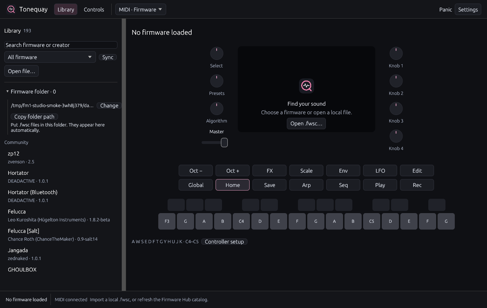

<p align="center"></p>
<h1 align="center">Tonequay</h1>
<p align="center">Your firmware. Your instrument.</p>

[](https://github.com/lkotlarenko/tonequay/actions/workflows/ci.yml)

Tonequay is a lightweight native Linux workstation for exploring and playing
M-VAVE FM-1 firmware, with MIDI controller integration, a firmware library, and
AppImage builds. It runs real firmware using
[Joakim Eriksson’s FM-1 emulator](https://github.com/joakimeriksson/fm1-emu).

**Early development:** the app has automated and native desktop smoke tests, but
physical controller playing and broad Linux distribution testing remain pending.
No firmware is bundled. Official M-VAVE packages must be supplied locally.

- Native Rust/egui interface with a pixel-sharp display, interactive panel,
  dark/light themes, adjustable font size and UI scale.
- Searchable Firmware Hub catalog, favorites, verified downloads and offline cache.
- A configurable firmware folder: add `.fwsc` files and they appear automatically.
- Guest MIDI passthrough or MIDI control of the emulated FM-1 panel, with MiniLab 3
  defaults, MIDI Learn, channel routing and a message inspector.
- Native audio, selectable buffering, isolated flash saves and backup tools.



Catalog metadata shown above: The Firmware Hub, CC BY 4.0.

## Getting started

Download the x86-64 AppImage from [Releases](https://github.com/lkotlarenko/tonequay/releases)
when a release is available:

```sh
chmod +x Tonequay-x86_64.AppImage
./Tonequay-x86_64.AppImage
```

Without FUSE, use `APPIMAGE_EXTRACT_AND_RUN=1 ./Tonequay-x86_64.AppImage`.
Open a local `.fwsc` file or choose a community package in the library. Set your
MIDI port in Controls → MIDI. The default mode forwards MIDI to the firmware;
FM-1 panel mode maps MIDI onto the virtual instrument’s keys, buttons and knobs.

See the [user guide](docs/FM1_STUDIO.md), [new controls and folder guide](docs/USER_GUIDE.md),
[build instructions](docs/BUILDING.md), and [test/compatibility report](docs/FM1_STUDIO_TEST_REPORT.md).

## Development

```sh
cargo run --locked -p tonequay
make test
make appimage
```

The desktop application lives in `crates/tonequay`; the existing `fm1-core` and
`fm1-soc` implement the emulator. Existing CLI tools remain available.
See [architecture](docs/ARCHITECTURE.md), [progress](docs/DEVELOPMENT_PROGRESS.md),
[contributing](CONTRIBUTING.md) and [release process](docs/RELEASING.md).
The upstream README and workflows are retained under `docs/upstream/` for reference.

## Credits and licensing

Tonequay builds on the MIT-licensed FM-1 emulator by **Joakim Eriksson**. Its CPU,
JIT, peripherals and firmware execution are reused rather than replaced.
The [MIT license](LICENSE) retains the upstream copyright notice.
[Credits and licensing details](CREDITS.md) identify the firmware catalog,
firmware authors, libraries, fonts and AppImage runtime. Firmware has its own
licenses; listing a package does not grant redistribution rights. Tonequay is
an independent project, unaffiliated with M-VAVE or Arturia.
