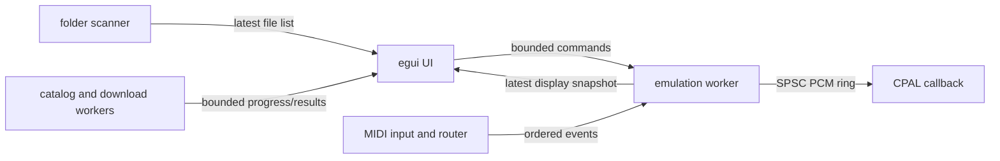

# Application architecture

Tonequay is a native Rust application. `crates/tonequay` depends directly on the
existing `fm1-core` and `fm1-soc`; it neither embeds a browser nor substitutes a
new synthesizer. The initial audited engine baseline was upstream commit
`3e3fb27` (workspace version 0.4.0). The historical audit is
[FM1_STUDIO_PLAN.md](FM1_STUDIO_PLAN.md).

| Module | Responsibility |
|---|---|
| `ui.rs`, `ui/` | Library, instrument, direct Learn, responsive toolbar, inspector and preferences; UI-owned settings |
| `theme.rs` | Appearance, contrast, font/scale bounds and interaction sizing |
| `runtime.rs` | Worker-owned machine, accurate CPU scheduling, switches and flash lifecycle |
| `audio.rs` | CPAL configuration, sample formats, rate conversion and output callback |
| `midi.rs` | ALSA/midir connection, routing, Learn, channels, held notes and inspector feedback |
| `panel_input.rs` | Ownership of physical keys shared by UI, MIDI and timed taps |
| `firmware_folder.rs` | Background directory scans and latest folder snapshots |
| `catalog.rs` | Catalog validation, refresh policy, creator downloads and integrity checks |
| `persistence.rs` | Bounded file reads, exact-hash save isolation and atomic writes |
| `desktop.rs` | Explicit desktop launcher/icon installation and safe path quoting |

The emulator worker owns the CPU/SoC and flash state. Runtime commands are bounded
to 1024 entries; overflow requests urgent note cleanup rather than retaining stale
holds. MIDI configuration and delivery share a router lock, separate from audio.
The audio callback owns the SPSC consumer and never performs filesystem/network
I/O, logging, heap allocation or mutex locking. The ring holds at most 48000
stereo frames. Device enumeration, dialogs, directory scans and HTTPS run off the UI.

The display mailbox retains one latest view; it uses nonblocking locks outside
the audio callback. Unchanged firmware pixels do not require texture uploads.
Folder scanning is non-recursive, ignores symlinks, and never auto-reboots a
running firmware. Background workers wake or stop through explicit ownership;
shutdown joins owned emulation/MIDI/folder threads.

A firmware switch stops and cleans the old session, persists its own flash,
validates and boots the new package, and restores only its exact package-hash
save. Invalid loads preserve the running session where validation happens before
replacement. The lifecycle smoke tests cover both successful switches and failed
loads. Native backups are deliberately distinct from upstream `.fm1save`.

## Maintaining the upstream relationship

The repository retains the upstream MIT copyright, source history, CLI, tests and
reference workflows. Its `origin` remote remains the emulator; `tonequay/main`
is the application branch. The new GitHub repository also retains an upstream
`master` snapshot. Do not blindly merge that branch into an app release: inspect
engine changes, rerun regressions and compare legal firmware audio/timing first.
CPU/JIT optimizations require profiling or a failing regression, not UI work.

Panic's emergency silence is separate from routing-change note cleanup. The
CPAL callback samples an atomic output gate per block, drains the ring normally
and substitutes silence while gated. It performs no new allocation, I/O or locking.
An explicit Resume removes the gate. Firmware and timing keep running.
Learn state is transient and excluded from saved profiles; captured assignments
use the existing mapping format. An explicit click layer supports drag-only
sliders as well as buttons/encoders, without invoking performance actions.
